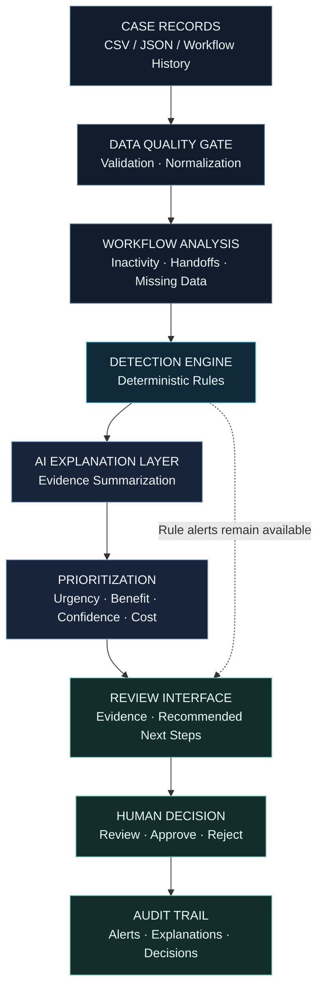

<!-- GHOST QUEUE | README.md -->

 

 

**An AI-assisted workflow auditor for cases that get stuck between processes.**

 

---

## 01 / THE PROBLEM

### A pending status does not explain a stalled process.

Administrative workflows can contain unresolved cases that repeatedly change departments, remain inactive, or encounter missing-information blockers.

Traditional deadline-based tracking may fail to surface combinations of warning signs before a case becomes overdue.

**Ghost Queue investigates the space between “still pending” and “actually progressing.”**

---

## 02 / THE SYSTEM

| DETECT | EXPLAIN | PRIORITIZE |
|:---:|:---:|:---:|
| Identify workflow anomalies | Trace alerts to evidence | Support human review |
| `RULE ENGINE` | `AI ANALYSIS` | `DECISION SUPPORT` |

Ghost Queue combines deterministic workflow checks with AI-assisted explanations. It is designed to help reviewers understand which cases may require attention and why.

### Core capabilities

- **Stagnation analysis** — detect unusual inactivity relative to workflow expectations.
- **Handoff analysis** — identify repeated departmental transfers without recorded progress.
- **Data-quality checks** — surface missing fields and malformed records.
- **Evidence-based explanations** — summarize the records and signals behind an alert.
- **Intervention prioritization** — compare urgency, expected benefit, confidence, and implementation cost.
- **Human oversight** — keep consequential decisions with authorized people.

---

## 03 / SYSTEM ARCHITECTURE

<strong>View the processing sequence</strong>

1. Ingest case records and workflow history.
2. Validate the input and identify data-quality issues.
3. Calculate workflow signals using transparent rules.
4. Generate an explanation from available evidence using an LLM.
5. Rank cases for review using configurable prioritization criteria.
6. Present alerts and supporting evidence to a human reviewer.
7. Record review outcomes for auditability and future evaluation.

---

## 04 / ENGINEERING PRINCIPLES

### Rules for detection. AI for explanation. Humans for decisions.

| Layer | Responsibility |
|---|---|
| Rule engine | Calculate inactivity, transfer frequency, missing fields, and other measurable signals. |
| AI layer | Summarize evidence and describe possible blockers without presenting speculation as fact. |
| Prioritization | Apply transparent criteria to support review ordering. |
| Human review | Decide whether an alert is valid and what action is appropriate. |
| Audit trail | Preserve the relationship between source evidence, alerts, and decisions. |

**Failure boundary:** an LLM failure should not erase an independently generated rule-based alert. Explanations must remain traceable to source evidence.

---

## 05 / TECHNOLOGY

| Component | Proposed technology |
|---|---|
| Workflow orchestration | n8n |
| Database | Supabase / PostgreSQL |
| Workflow logic | JavaScript |
| AI explanations | Gemini or compatible LLM API |
| Input | CSV / JSON |
| Interface | Web-based review dashboard |

> The architecture above describes the intended system. Update this section to distinguish implemented components from planned integrations before presenting the repository as a working prototype.

---

## 06 / VALIDATION

Ghost Queue should be evaluated against simpler approaches rather than judged only by whether its interface looks convincing.

| Baseline | Evaluation question |
|---|---|
| Oldest-first | Does case age alone identify the right cases? |
| Overdue-only | Are deadline alerts sufficient? |
| Multi-signal rules | Does combining workflow signals improve detection? |
| Rules + AI explanation | Do explanations improve reviewer understanding? |

**Metrics**

- Precision and recall of flagged cases
- False-positive rate
- Detection of high-priority cases
- Traceability of explanations
- Usefulness of recommendations to reviewers

Synthetic-data results can demonstrate technical behavior, but they cannot establish real-world effectiveness.

---

## 07 / RESPONSIBLE AI

**AN ALERT IS EVIDENCE FOR REVIEW — NOT A VERDICT.**

- Minimize the use of personal and sensitive information.
- Do not equate missing records with wrongdoing.
- Account for legitimate waiting periods and process-specific constraints.
- Keep explanations grounded in the supplied evidence.
- Require human review before consequential action.
- Measure false positives and assess the risk of unfair prioritization.

---

## 08 / TEAM

| Member | Responsibility |
|---|---|
| **Aparajita Singh** | Case investigation |
| **Anamika Sharma** | Problem statement and evidence |
| **Anushka Shukla** | Solution development |
| **Angel Jain** | Workflow design |

**HACKLABS**  
AI Synergy Hackathon 2026 · AI for All

---

GHOST QUEUE / WORKFLOW INTELLIGENCE / HUMAN-CENTERED AI

  

*Making invisible workflow failures visible.*

