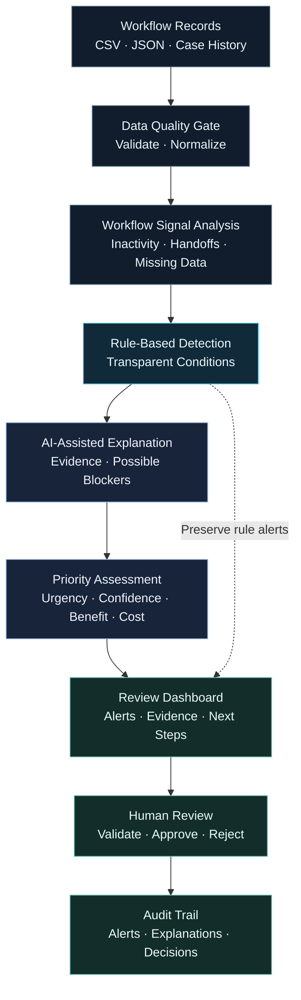

# 👻 GHOST QUEUE — Workflow Intelligence

  
   

  

    <strong>Detect stagnation. Trace workflow failures. Prioritize intervention.</strong>
  

<!-- GHOST QUEUE | README.md -->

 

 

**An AI-assisted workflow auditor that helps uncover why cases stall, where processes break down, and what deserves human attention first.**

 

---

## 01 / THE PROBLEM

### A case marked “pending” can hide a much bigger problem.

Across administrative and service-delivery workflows, cases can remain unresolved because of missing information, repeated handoffs, unclear ownership, or long periods of inactivity.

A status label tells us where a case stands. It rarely explains **why it is stuck, what has gone wrong, or what should happen next.**

Traditional tracking often relies on deadlines and manual follow-ups. These methods can overlook combinations of warning signs until delays become harder to resolve.

Ghost Queue focuses on the gap between a case being *open* and a case actually *moving forward*.

**Our mission:** make invisible workflow failures visible before they become prolonged delays.

---

## 02 / THE SOLUTION

### From scattered workflow records to actionable insights.

Ghost Queue combines transparent rule-based detection with AI-assisted analysis to help reviewers identify stalled workflows, understand possible blockers, and prioritize cases for investigation.

| DETECT | EXPLAIN | PRIORITIZE |
|:---:|:---:|:---:|
| Find unusual workflow patterns | Connect alerts to recorded evidence | Support informed human intervention |
| `RULE ENGINE` | `AI ANALYSIS` | `HUMAN REVIEW` |

### Core capabilities

- **Stagnation detection** — identify unusual inactivity against configurable workflow expectations.
- **Handoff tracing** — detect repeated transfers between departments without corresponding progress.
- **Missing-information analysis** — surface incomplete fields, missing updates, and potential blockers.
- **Ghost Signals** — combine multiple workflow anomalies to highlight cases that may deserve closer review.
- **Evidence-linked explanations** — show which records and signals contributed to an alert.
- **Intervention prioritization** — organize review queues using urgency, confidence, expected benefit, and implementation cost.
- **Human-in-the-loop decisions** — let authorized reviewers validate alerts and decide what action to take.

**The goal is not to replace people who manage workflows. It is to help them notice what ordinary status tracking misses.**

---

## 03 / HOW IT WORKS

### The workflow

1. **Ingest:** load available case records and workflow history.
2. **Validate:** check data quality and normalize relevant fields.
3. **Detect:** calculate measurable workflow signals using explicit rules.
4. **Explain:** use an AI model to summarize evidence and suggest possible explanations.
5. **Prioritize:** rank cases using configurable criteria rather than opaque model judgments alone.
6. **Review:** present alerts, supporting records, and potential next steps to a human.
7. **Record:** preserve the alert, explanation, and review outcome for auditability.

<strong>What makes a Ghost Signal?</strong>

A Ghost Signal is a workflow warning produced when available records indicate a possible breakdown in progress.

For example, a case may have been inactive for an unusually long period, transferred between departments several times, and still be missing a required update.

Individually, these signals may have reasonable explanations. Together, they can justify a closer look.

Ghost Signals are **indicators for review, not proof of negligence or wrongdoing**. Their interpretation depends on the workflow, data quality, and human judgment.

---

## 04 / HUMAN + AI SYNERGY

### Rules detect. AI explains. Humans decide.

Ghost Queue is designed around complementary strengths rather than fully autonomous decision-making.

| Human intelligence | AI assistance |
|---|---|
| Understands operational context | Processes available records consistently |
| Recognizes exceptions and legitimate delays | Surfaces patterns across multiple signals |
| Challenges incorrect assumptions | Drafts evidence-linked explanations |
| Makes accountable decisions | Helps compare possible next steps |

### Why combine them?

A rule engine can identify a measurable anomaly without understanding its operational meaning. An AI model can generate a plausible explanation that still needs verification. A human reviewer can bring context and accountability, but may struggle to manually inspect large volumes of records.

Together, these capabilities can support faster, more transparent review.

**Example:** Ghost Queue flags an unusually inactive case with repeated departmental transfers. AI summarizes the recorded timeline and identifies missing updates. A human reviewer checks the underlying records before deciding whether intervention is needed.

---

## 05 / ENGINEERING ARCHITECTURE

### A reliable detection layer, with AI as an explainability layer.

| Layer | Responsibility |
|---|---|
| Data ingestion | Accept structured workflow records such as CSV or JSON |
| Validation | Check required fields, inconsistent formats, and incomplete records |
| Rule engine | Calculate inactivity, repeated handoffs, and other measurable signals |
| AI explanation layer | Summarize source evidence and describe possible blockers |
| Prioritization | Apply configurable, transparent review criteria |
| Review interface | Display alerts, evidence, explanations, and suggested next steps |
| Audit trail | Preserve decisions and the evidence associated with each alert |

### Failure boundaries

- Rule-based alerts should remain available if the AI service fails.
- AI explanations should reference available evidence and distinguish facts from hypotheses.
- Missing data should not automatically be interpreted as misconduct.
- Priority scores should be inspectable and configurable.
- Consequential actions must remain subject to authorized human review.

---

## 06 / TECHNOLOGY STACK

| Component | Technology |
|---|---|
| Workflow orchestration | n8n |
| Database and persistence | Supabase / PostgreSQL |
| Workflow rules | JavaScript |
| AI-assisted explanations | Adaption model/API integration, where supported |
| Input formats | CSV / JSON |
| Review experience | Web-based dashboard |

> **Implementation transparency:** update this section as components are integrated. A planned integration should not be presented as a completed feature. Model access, API configuration, and supported capabilities must be verified in the actual deployment.

---

## 07 / VALIDATION & EVALUATION

### A convincing demo should prove more than a convincing interface.

Ghost Queue should be evaluated against simpler alternatives to determine whether multi-signal detection and AI explanations add measurable value.

| Baseline | What we evaluate |
|---|---|
| Oldest-first queue | Can case age alone identify cases needing attention? |
| Overdue-only rules | Do deadline alerts miss cases that are stalled but not yet overdue? |
| Multi-signal detection | Does combining workflow indicators improve prioritization? |
| Rules + AI explanations | Do evidence-linked explanations improve reviewer understanding? |

### Evaluation metrics

- **Precision:** what proportion of flagged cases genuinely merit review?
- **Recall:** how many relevant stalled cases are detected?
- **False-positive rate:** how often are legitimate cases incorrectly flagged?
- **Evidence traceability:** can reviewers identify the records behind an alert?
- **Explanation quality:** are explanations accurate, grounded, and understandable?
- **Reviewer usefulness:** do the results help reviewers decide what to investigate next?

Synthetic datasets can demonstrate expected system behavior. They do not, by themselves, establish effectiveness in real-world administrative workflows.

No benchmark or performance claim should be published until it has been measured and documented.

---

## 08 / RESPONSIBLE AI

**AN ALERT IS A REASON TO REVIEW — NOT A VERDICT.**

Ghost Queue is intended to support responsible workflow oversight.

- **Privacy first:** use only the data necessary for the task.
- **Evidence over speculation:** distinguish recorded facts from AI-generated hypotheses.
- **Context matters:** account for legitimate waiting periods and workflow-specific rules.
- **Human accountability:** keep consequential decisions with authorized people.
- **Fair prioritization:** evaluate false positives and potential sources of bias.
- **Auditable outcomes:** preserve the basis for alerts and the results of human review.

The system should help people understand workflow problems without automatically assigning blame to individuals or departments.

---

## 09 / TEAM HACKLABS

| Member | Responsibility |
|---|---|
| **Aparajita Singh** | Case investigation |
| **Anamika Sharma** | Problem statement and evidence |
| **Anushka Shukla** | Solution development |
| **Angel Jain** | Workflow design |

**HACKLABS**  
AI Synergy Hackathon 2026 · AI for All

---

GHOST QUEUE / WORKFLOW INTELLIGENCE / HUMAN-CENTERED AI

  

*Making invisible workflow failures visible.*

